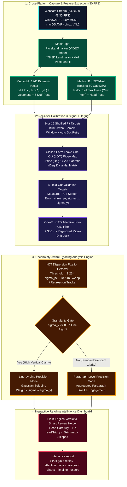
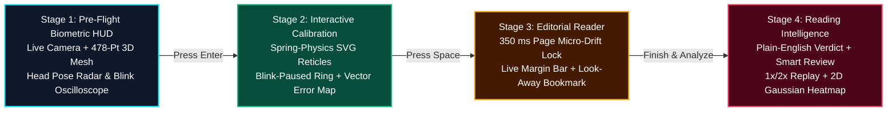

<div align="center">

#  GazeRead: Uncertainty-Aware Webcam Gaze Tracking & Cognitive Reading Analytics

**Turning an ordinary consumer laptop webcam into an honest, mathematically rigorous biometric reading & attention instrument.**

[](#quick-start-windows--macos--linux)
[](#1-mediapipe-478-point-3d-mesh--5-point-iris-geometry)
[](#3-method-b-deep-appearance-gaze-with-l2cs-net)
[](#system-architecture--data-flow)
[](#privacy--ethics-guarantees)
[](#reproducing-the-scientific-benchmarks)

<br/>

[** Quick Start**](#-quick-start-windows--macos--linux) ·
[** Why This Project Exists**](#-the-core-research-problem-why-this-project-exists) ·
[** System Architecture**](#️-system-architecture--data-flow) ·
[** CV & Math Deep-Dive**](#-computer-vision--mathematical-pipeline) ·
[** Plain-English Glossary**](#-plain-english-glossary-of-every-technical-term) ·
[** 4-Stage UI Walkthrough**](#-the-4-stage-biometric--reading-intelligence-experience) ·
[** Real-World Applications**](#-real-world-applications--use-cases) ·
[** Benchmarks & Evaluation**](#-reproducing-the-scientific-benchmarks)

</div>

---

##  The Core Research Problem: Why This Project Exists

Dedicated infrared hardware eye trackers (such as **Tobii Pro Spectrum** or **EyeLink 1000**) cost **$5,000–$25,000+**, use active near-infrared corneal reflection illuminators at 250–1000 Hz, and achieve **$\sim 0.5^\circ$ of visual angle accuracy** (enough to resolve individual words).

By contrast, **every laptop already has a standard 30 FPS RGB webcam**—but consumer webcams face fundamental physical constraints:
1. **Low Spatial Resolution at the Eye**: At a normal reading distance of $50\text{–}70\text{ cm}$, a reader's entire iris spans only **12–18 pixels** in a $640 \times 480$ webcam frame.Moving your gaze vertically from one line of text to the next rotates your eyeball by **$< 0.8^\circ$**, shifting the iris center by **less than 1 pixel**.
2. **Head-Pose Coupling**: A tiny $1^\circ$ head tilt or a $1\text{ cm}$ slouch shifts the eye appearance in the camera frame far more than a reading saccade across a sentence.
3. **The Problem with Existing Webcam Gaze Demos**: Almost all webcam eye-tracking demos display a jittery red dot and falsely claim word-level precision, without ever measuring or accounting for the webcam's actual error radius ($\sim 2^\circ\text{–}3^\circ$, or **$35\text{–}75\text{ px}$** on screen).

###  How GazeRead Solves This Differently

Instead of faking word-level accuracy, **GazeRead is an uncertainty-aware biometric instrument**:
- **Self-Quantified Uncertainty ($\sigma_x, \sigma_y$)**: Every session ends calibration with **5 held-out validation targets** (that were never used to fit the regression model) to measure your exact horizontal ($\sigma_x$) and vertical ($\sigma_y$) RMS error in screen pixels.
- **Physics-Driven Granularity Selection**:
  - If your measured vertical error satisfies **$\sigma_y \le \frac{1}{2}\,\text{Line Pitch}$** (e.g., $\sigma_y \le 33\text{ px}$ for $66\text{ px}$ line spacing), GazeRead unlocks **Line-by-Line Tracking Clarity**.
  - Otherwise, it automatically switches to **Paragraph-Level Tracking Clarity** using **Soft Gaussian Credit Assignment** ($w_i \propto \exp\!\big(-\frac{(y - y_i)^2}{2\sigma_y^2}\big)$), propagating your measured calibration uncertainty directly into the attention heatmap.
- **Plain-English Reading Intelligence**: Translates raw gaze trajectories, fixations, and backward regressions into human-understandable diagnostics: **Reading Pace (WPM)**, **Focus & Attention (%)**, **Backtracking / Re-reads**, and a **Smart Review Helper** that automatically extracts the exact paragraphs you skipped, skimmed, or struggled with.

---

##  System Architecture & Data Flow



---

##  Computer Vision & Mathematical Pipeline

### 1. MediaPipe 478-Point 3D Mesh & 5-Point Iris Geometry
Implemented in [`src/gazeread/features/landmarks.py`](src/gazeread/features/landmarks.py) and [`src/gazeread/gaze/backend_landmark.py`](src/gazeread/gaze/backend_landmark.py):

- **478 3D Landmarks**: MediaPipe `FaceLandmarker` runs in temporal `VIDEO` mode (`output_facial_transformation_matrixes=True`), outputting 468 facial mesh vertices plus **10 dedicated iris landmarks** (`468..472` for the subject's right eye, `473..477` for the left eye).
- **5-Point Iris Centroid (`iris_center_5pt`)**: Instead of relying on a single center landmark, GazeRead averages the pupil center with its 4 cardinal iris-ring vertices:
  $$\mathbf{c}_{\text{iris}} = \frac{1}{5}\sum_{k \in \{\text{center}, \text{ring}_{1..4}\}} \mathbf{p}_k$$
- **Eye-Coordinate Projection ($u, v$)**: For each eye (`right`: corners `33, 133`, lids `159, 145`; `left`: corners `263, 362`, lids `386, 374`), the iris offset is projected onto the local inner-to-outer corner axis $\hat{\mathbf{e}}_u$ and its image-downward perpendicular $\hat{\mathbf{e}}_v$, normalized by the eye corner width $w_{\text{eye}} = \|\mathbf{p}_{\text{outer}} - \mathbf{p}_{\text{inner}}\|$:
  $$u = \frac{(\mathbf{c}_{\text{iris}} - \mathbf{c}_{\text{eye}}) \cdot \hat{\mathbf{e}}_u}{w_{\text{eye}}}, \qquad v = \frac{(\mathbf{c}_{\text{iris}} - \mathbf{c}_{\text{eye}}) \cdot \hat{\mathbf{e}}_v}{w_{\text{eye}}}$$
- **Eyelid Openness & Blink Gate**:
  $$\text{openness} = \frac{\|\mathbf{p}_{\text{upper}} - \mathbf{p}_{\text{lower}}\|}{w_{\text{eye}}}$$
  Frames with $\text{openness} < 0.15$ on either eye are immediately flagged as `valid = False` (blinks), pausing calibration sample collection and holding the One-Euro filter state.

### 2. 6-DoF Head Pose Extraction
Implemented in [`src/gazeread/features/head_pose.py`](src/gazeread/features/head_pose.py):
- Extracts the $3\times 3$ rotation block $\mathbf{R}$ and 3D translation vector $\mathbf{t} = (t_x, t_y, t_z)$ in centimetres from MediaPipe's $4\times 4$ canonical face transformation matrix.
- Computes ZYX Euler angles $(\text{yaw}, \text{pitch}, \text{roll})$ in degrees and gates out extreme head turns ($|\text{yaw}| > 30^\circ$ or $|\text{pitch}| > 25^\circ$).
- Supplies the **12-D Biometric Feature Vector**:
  $$\mathbf{x} = \big[u_R, v_R, u_L, v_L, \text{open}_R, \text{open}_L, \text{yaw}, \text{pitch}, \text{roll}, t_x, t_y, t_z\big]^\top$$

### 3. Method B: Deep Appearance Gaze with L2CS-Net
Implemented in [`src/gazeread/gaze/backend_l2cs.py`](src/gazeread/gaze/backend_l2cs.py) and [`src/gazeread/gaze/l2cs_model.py`](src/gazeread/gaze/l2cs_model.py):
- Crops a $1.2\times$ square bounding box around the detected facial landmarks, resizes to $448\times 448$, and passes it through a **ResNet-50 L2CS-Net** backbone (official Gaze360 weights).
- Decodes 90 discrete $4^\circ$ bins via softmax expectation for both gaze yaw and pitch, optionally combined with MediaPipe head pose (`B+pose`), allowing side-by-side paired comparisons (`--compare`) against Method A on the exact same calibration dots.

### 4. Closed-Form Leave-One-Out (LOO) Ridge Calibration
Implemented in [`src/gazeread/gaze/calibration.py`](src/gazeread/gaze/calibration.py):
- Standardizes features across the $N \in \{9, 16\}$ shuffled calibration dots and evaluates both **Affine (Degree 1)** and **Quadratic (Degree 2)** polynomial expansions across a 15-point logarithmic grid of Ridge penalties $\alpha \in [10^{-4}, 10^3]$ (leaving the intercept unpenalized).
- Computes exact **Leave-One-Dot-Out (LOO) residuals** in closed form using the leverage entries $H_{ii}$ of the hat matrix $\mathbf{H} = \mathbf{A}(\mathbf{A}^\top\mathbf{A} + \mathbf{P}_\alpha)^{-1}\mathbf{A}^\top$:
  $$\mathbf{r}_i^{\text{LOO}} = \frac{\mathbf{y}_i - \hat{\mathbf{y}}_i}{1 - H_{ii}}$$
- Degree 2 is selected only if it beats Degree 1's LOO RMS error by at least $10\%$ (`poly2_margin = 0.10`), preventing overfitting on 9-point grids.

### 5. Adaptive One-Euro Filtering, I-DT Fixations & Soft Gaussian Mapping
Implemented in [`src/gazeread/gaze/filters.py`](src/gazeread/gaze/filters.py), [`src/gazeread/analysis/fixations.py`](src/gazeread/analysis/fixations.py), and [`src/gazeread/analysis/line_mapping.py`](src/gazeread/analysis/line_mapping.py):
- **2D One-Euro Filter**: Dynamically increases the low-pass cutoff frequency $f_c = f_{c,\min} + \beta |\dot{x}|$ during fast saccades (eliminating lag) while heavily smoothing slow fixation jitter.
- **Zero-Effort Page Micro-Drift Lock**: Pulses a $350\text{ ms}$ visual anchor on the first word of each new page, applying a bounded EWMA offset correction ($\le 55\text{ px}$) to cancel out slow postural slouching between pages.
- **Soft Gaussian Line & Paragraph Mapping**: Each fixation or gaze sample $(x, y, \Delta t)$ within the text column distributes its time $\Delta t$ across lines $i = 1\dots M$ with Gaussian weights scaled by the user's measured vertical validation error $\sigma_y$:
  $$w_i(y) = \frac{\exp\!\left(-\frac{(y - y_{c,i})^2}{2\sigma_y^2}\right)}{\sum_{j=1}^M \exp\!\left(-\frac{(y - y_{c,j})^2}{2\sigma_y^2}\right)}$$

---

## 📖 Plain-English Glossary of Every Technical Term

We designed the UI so **normal users see clear, everyday English**, while researchers can still inspect the underlying mathematical metrics:

| Technical Term in Code/Logs | Plain-English UI Label | What It Actually Means |
| :--- | :--- | :--- |
| **$\sigma_{\text{px}}$ (`sigma_px`)** | **Tracking Accuracy** | Your overall gaze error radius in screen pixels, measured on 5 test dots *after* calibration. Lower is better ($\sim 40\text{–}75\text{ px}$ is typical on a laptop webcam). |
| **$\sigma_y$ (`rms_y`)** | **Vertical Error vs. Line Height** | How much your predicted gaze bounces up and down vertically. Because reading lines are stacked vertically, $\sigma_y$ determines whether the camera can tell lines apart. |
| **`granularity` (`line` vs `paragraph`)** | **Webcam Tracking Clarity** | **Line-by-Line** if $\sigma_y \le \frac{1}{2}\text{Line Height}$ ($33\text{ px}$); otherwise **Paragraph Clarity** (so the app never lies about line accuracy when noise is too high). |
| **`loo_rms_px` (LOO RMS)** | **Calibration Fit Quality** | Leave-One-Out cross-validation error during calibration: predicts each calibration dot from the *other* dots to verify you didn't blink or look away. |
| **One-Euro Filter** | **Adaptive Gaze Smoothing** | A speed-aware filter that keeps the gaze spotlight rock-steady when you stare at a word, but snaps instantly when your eyes jump to a new line. |
| **I-DT Fixation** | **Eye Pause / Fixation** | When your eyes lock onto a small region for $\ge 100\text{ ms}$. Reading is a sequence of fixations (where comprehension happens) separated by fast jumps (*saccades*). |
| **Regression** | **Backtracking (Re-read)** | When your eyes jump *backward* to an earlier part of the same line or an earlier line in the paragraph because a sentence was dense or confusing. |
| **Return Sweep** | **Line-to-Line Sweep** | The diagonal eye movement from the right end of one line to the left start of the next line down. |
| **Soft Gaussian Mapping** | **Smooth Attention Glow** | Instead of assigning 100% of a noisy gaze point to whichever line is 1 pixel closer, it shares credit smoothly across nearby lines based on your camera's $\sigma_y$. |

---

##  The 4-Stage Biometric & Reading Intelligence Experience



1. **Stage 1 — Pre-Flight Biometric HUD**:
   - **Live Camera + 478-Point 3D Cyber-Mesh**: Mirrored in-memory camera preview overlaid with your live 3D facial wireframe and glowing emerald 5-point iris vectors.
   - **Readiness Gauges**: Live **Head Pose & Distance Radar** (highlighting the $50\text{–}70\text{ cm}$ sweet spot) and a dual-channel **Left/Right Eye-Openness Oscilloscope** showing blinks against the $0.15$ threshold.
   - **Passage & Mode Selector**: Choose built-in passages (`Alice Passage 1–3`, `Alice Excerpts`), paste any custom text, pick 9- or 16-point calibration, select feature vectors (`iris_pose`, `iris_pose_6dof`, `full`), and switch reader themes (`Warm Sepia`, `Cyber Dark`, `Crisp Light`).
2. **Stage 2 — Interactive Precision Calibration**:
   - **Spring-Physics Target Reticles**: Targets glide smoothly across the screen using critically damped spring physics rather than teleporting abruptly.
   - **Blink-Aware Sample Ring & Auto-Retry**: The progress ring pauses if you blink so blinks never corrupt calibration, and automatically re-presents any missed dot.
   - **Calibration Accuracy Report Card**: Displays a 2D Vector Error Map of the 5 held-out validation points, sample clouds, and plain-English Tracking Clarity before reading starts.
3. **Stage 3 — Editorial Reader with Micro-Drift Lock & Auto-Resume**:
   - **350 ms Page-Start Micro-Drift Anchor**: Gently zeros out head-slouch drift at the top-left of every page.
   - **Live Paragraph Margin Bar**: A soft cyan bar in the left margin smoothly highlights whichever paragraph your eyes are currently reading.
   - **Auto-Resume Gaze Bookmark**: Look away from the screen for $\ge 2.5\text{ s}$ and look back—the exact line where you left off softly glows to guide your eyes back.
4. **Stage 4 — Plain-English Reading Intelligence Dashboard**:
   - **Plain-English Verdict Banner**: Summarizes how many paragraphs you read carefully (` Read Carefully`), struggled with (`Re-read / Tricky`), skimmed (` Skimmed Quickly`), or skipped (` Skipped Over`), alongside realistic **Reading Pace (WPM)** and **Focus Score**.
   - ** Smart Study & Review Helper**: Automatically pulls out the full text of any paragraph you skipped, skimmed, or found tricky so you can review your exact blind spots.
   - **Interactive report views**: **1× / 2× Animated Gaze Replay ("Watch Your Eyes Read")**, **Smooth 2D Gaussian Attention Heatmap**, paragraph/line heatmaps, attention-by-paragraph bars, reading-mode distribution, second-by-second journey timeline, and **1-Click HTML/JSON/PNG Report Export**.

---

##  Real-World Applications & Use Cases

Why does uncertainty-aware paragraph-level webcam tracking matter in practice?

1. ** EdTech & Adaptive Study Assistants**:
   - Detects when a student zones out, skims over a section, or repeatedly backtracks on a difficult paragraph—automatically surfacing explanations or review flashcards for those exact paragraphs without manual prompting.
2. ** Remote UX, Copywriting & Document Design Testing**:
   - Lets product teams, writers, and researchers test where readers actually spend time vs. what they ignore in landing pages, articles, resumes, or documentation across any laptop webcam—without bringing participants into a $10,000 hardware eye-tracking lab.
3. ** Cognitive & Clinical Reading Screening Research**:
   - Reading cadence, fixation stability, return-sweep accuracy, and regression frequency are key digital biomarkers studied in reading difficulties, visual fatigue, and attention research.
4. ** High-Stakes Compliance & Proof-of-Reading**:
   - Verifies whether critical safety bulletins, medical consent forms, or legal disclosures were genuinely read paragraph-by-paragraph rather than blindly scrolled past.
5. ** Human-AI Attention Alignment**:
   - Capturing real human reading dwell shares over text passages provides natural human attention distributions to compare against LLM token/paragraph importance weights.

---

##  Quick Start (Windows · macOS · Linux)

### 1. Run the Live Biometric App

From the root directory (`D:\Work\GazeTracker` or `D:\Work\GazeTracker\GazeTracker`):

**Windows (PowerShell):**
```powershell
# Launch with live webcam (30 FPS DirectShow MJPG + MediaPipe 3D FaceLandmarker):
$env:PYTHONPATH="src"; python -m gazeread.app.server --open

# Or test without a webcam using the interactive 3D synthetic simulator:
$env:PYTHONPATH="src"; python -m gazeread.app.server --source synthetic --open
```

**macOS / Linux:**
```bash
make setup        # creates .venv, installs requirements, downloads models/face_landmarker.task
make app          # launches server and opens http://127.0.0.1:8000
```

### 2. CLI Options & Modes

```powershell
# 16-point high-precision calibration grid with full 6-DoF head pose features:
$env:PYTHONPATH="src"; python -m gazeread.app.server --n-points 16 --features iris_pose_6dof --open

# Select a specific passage (alice_passage1, alice_passage2, alice_passage3, alice_excerpts):
$env:PYTHONPATH="src"; python -m gazeread.app.server --text alice_passage1 --open

# Run both Method A (MediaPipe Iris+Pose) and Method B (L2CS-Net Deep Gaze) in paired comparison mode:
$env:PYTHONPATH="src"; python -m gazeread.app.server --compare --open
```

### 3. Keyboard Shortcuts Inside the App

| Stage | Key / Action | Function |
| :--- | :--- | :--- |
| **Stage 1 (HUD)** | `Enter` or Click Button | Enter fullscreen and initialize calibration |
| **Stage 2 (Report Card)** | `Space` / `C` | Start reading session (`Space`) or Recalibrate (`C`) |
| **Stage 3 (Reading)** | `Space` | Advance to next page (or finish on the last page) |
| **Stage 4 (Dashboard)** | `1` / `2` / `3` / `4` | Switch between **Replay**, **Heatmap**, **Verdict & Review**, and **Export** tabs |
| **Stage 4 (Heatmap)** | `G` / `P` / `L` / `S` / `F` | Toggle **Gaussian Glow**, **Paragraphs**, **Lines**, **Scanpath**, or **Fixations/Samples** |
| **Stage 4 (Pages)** | `←` / `→` | Navigate between reading pages |
| **Any Stage** | `C` / `H` | Recalibrate (`C`) or toggle floating telemetry HUD (`H`) |

---

##  Reproducing the Scientific Benchmarks

All experimental pipelines are deterministic and seeded:

```powershell
# Run the full unit test suite (103 tests):
Set-Location GazeTracker; $env:PYTHONPATH="src"; python -m pytest -q

# M4: Synthetic reading simulation & typography design guidelines (~90 s):
$env:PYTHONPATH="src"; python -m gazeread.eval.sim_experiments

# Offline deterministic session replay verification:
$env:PYTHONPATH="src"; python scripts/replay_session.py sessions/<session_id> --check

# M6: Human check tables (re-analyses sessions recorded while the app still had its comprehension quiz;
# the quiz has since been removed from the app):
$env:PYTHONPATH="src"; python -m gazeread.eval.human_check
```

### Pre-Computed Research Summaries & Figures in `results/`
- **Simulation & Typography Design Guidelines (`SPEC.md` §7.3)**: [`results/sim_summary.md`](results/sim_summary.md)
- **MPIIFaceGaze Leave-One-Person-Out Evaluation (`SPEC.md` §7.1)**: [`results/m5_summary.md`](results/m5_summary.md)
- **Human Reading & Comprehension Check (`SPEC.md` §7.4)**: [`results/m6_summary.md`](results/m6_summary.md)
- **Full Technical Specification**: [`SPEC.md`](SPEC.md) · **Citations & Model Provenance**: [`CITATIONS.md`](CITATIONS.md)

---

## 🔒 Privacy & Ethics Guarantees

- **Zero Video or Image Storage**: Camera frames are processed strictly in volatile RAM to extract landmark coordinates and are immediately discarded. `sessions/<id>/events.jsonl` stores only numeric feature vectors, screen coordinates, and timing events.
- **100% Local Execution**: Runs entirely on `127.0.0.1` with zero external API calls, cloud uploads, or third-party telemetry.
